# Plataforma CPC — Diagramas de flujo del sistema

**Base tecnológica:** Laravel 13, PHP 8.3, Vue 3, Inertia.js, Spatie Laravel Permission y MySQL.

> **Criterio de documentación:** se reflejan las reglas y módulos que se han trabajado en el proyecto. Los elementos que se han descrito como pendientes o en proceso se marcan como tales y no se presentan como funcionalidades terminadas.

## 1. Flujo general: autenticación, privacidad, contraseña y acceso por rol

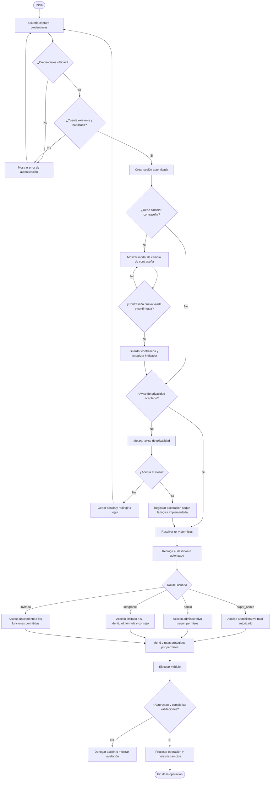

## 2. Roles y alcance de acceso

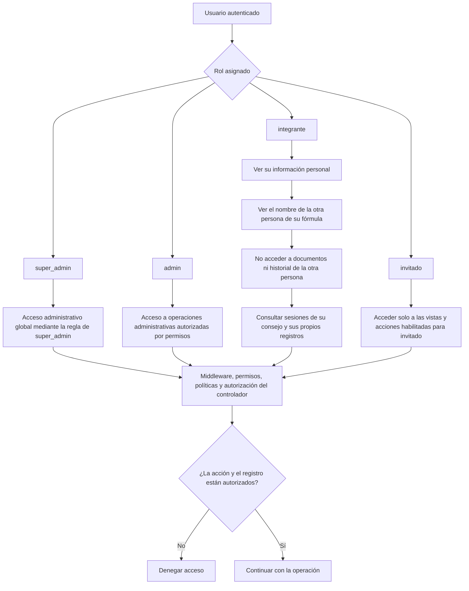

**Reglas transversales de seguridad**
- Ocultar una opción del menú no sustituye la autorización del backend.
- Validar tanto el permiso para ejecutar la acción como la pertenencia del registro al usuario, fórmula o consejo correspondiente.
- Un integrante puede identificar a su compañero de fórmula, pero no consultar sus documentos ni su historial individual.
- Las rutas, controladores, políticas y consultas deben aplicar el mismo alcance de acceso.
- `super_admin` cuenta con una regla global de autorización; las operaciones de `admin` dependen de sus permisos.

## 3. Mapa de módulos

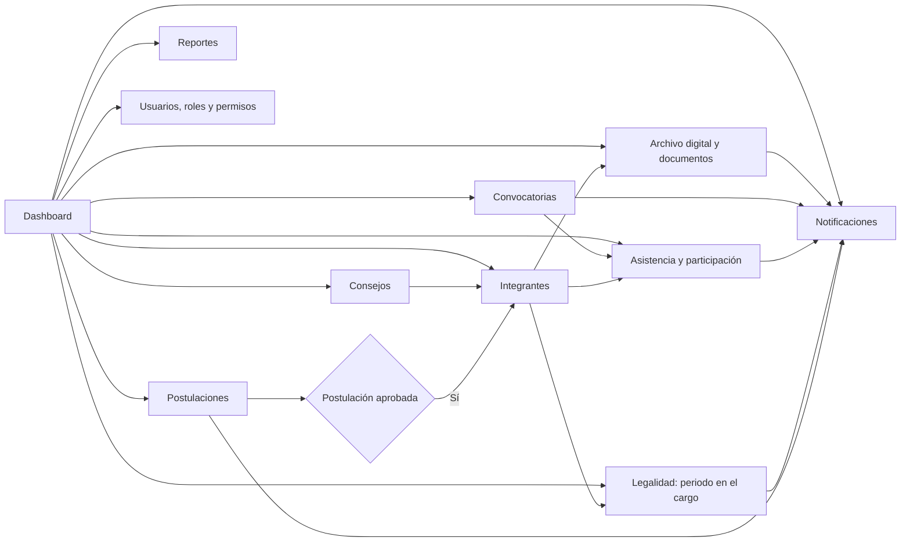

## 4. Consejos e integrantes

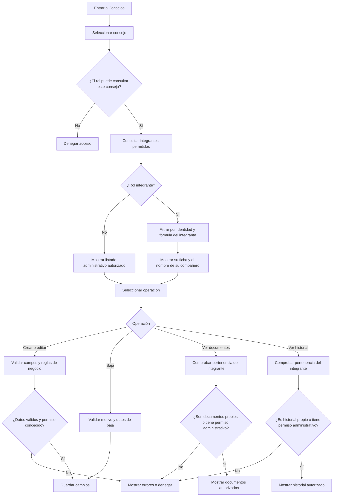

### Reglas de negocio relacionadas
- El catálogo contempla 22 consejos.
- Una fórmula está integrada por exactamente 2 integrantes.
- Se ha trabajado con un mínimo de 10 fórmulas por consejo; el máximo de 20 debe tratarse como regla configurable/pendiente de corroboración antes de presentarlo como definitivo.
- Se contempla un máximo de 2 periodos por integrante dentro del mismo consejo.
- Las bajas distinguen motivos como inasistencia y fin de periodo, según el modelo definido.

## 5. Archivo digital y validación de documentos

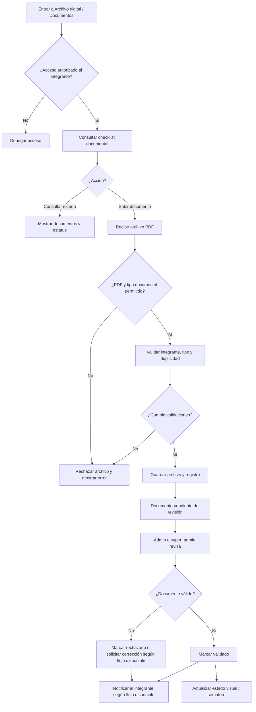

**Tipos documentales trabajados:** INE, comprobante domiciliario, carta bajo protesta (art. 170), integración de fórmula, currículum vitae, carta de motivos (opcional) y cumplimiento de normatividad. Se ha manejado un máximo de 7 documentos para el registro inicial; la carta de motivos es opcional.

## 6. Postulaciones

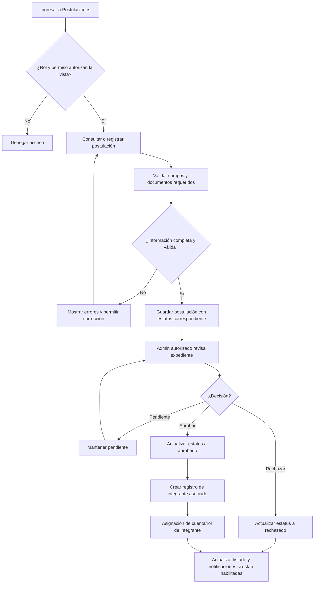

**Nota de alcance:** la aprobación y creación del integrante forman parte del flujo de negocio definido. La creación automática de la cuenta de usuario asociada y la asignación de rol se han planteado como trabajo por completar; deben marcarse como pendientes hasta verificar el código actual.

## 7. Convocatorias, sesiones, asistencia y participación

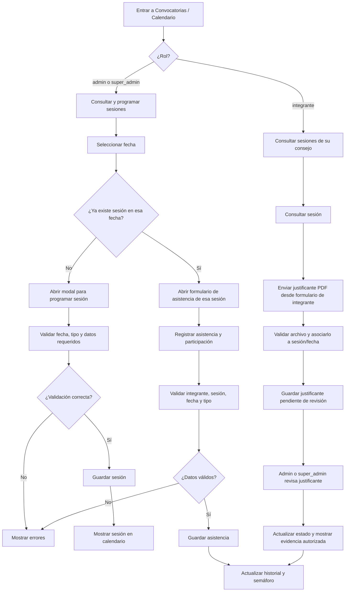

**Validación clave:** una sesión no debe marcarse como realizada si su convocatoria no está previamente marcada como realizada. Los registros deben asociarse a la sesión correcta, evitando desfases de fecha o asociación con otra sesión. El calendario es consultable por integrantes; las acciones administrativas de programación y captura se restringen según rol.

## 8. Legalidad: periodo en el cargo

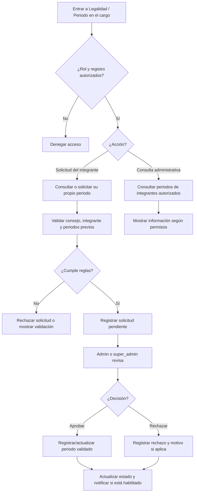

La regla trabajada establece un máximo de dos periodos por integrante en el mismo consejo. El flujo de solicitud y notificación de periodos se ha considerado una fase posterior y debe identificarse como pendiente si aún no está implementado por completo.

## 9. Reportes y dashboard

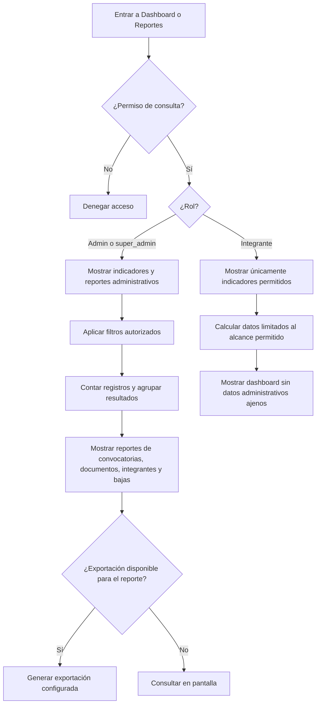

Los reportes trabajados contemplan conteos (sin porcentajes), una tabla dinámica de convocatorias, checklist documental y tabla de bajas. Se indicó que la tabla de bajas no requiere exportación. El dashboard de integrante debe recibir datos compatibles con sus componentes y no depender de propiedades administrativas ausentes.

## 10. Notificaciones

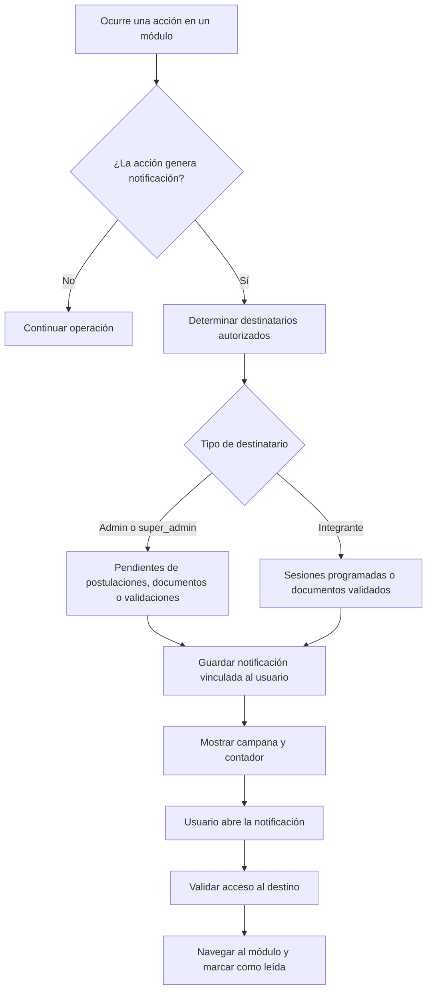

Las notificaciones deben filtrarse en backend por usuario, rol y relaciones pertinentes; no basta con ocultarlas en la interfaz. La notificación de resolución de solicitudes de periodo se dejó para una fase posterior.

## 11. Cierre de sesión y protección de datos

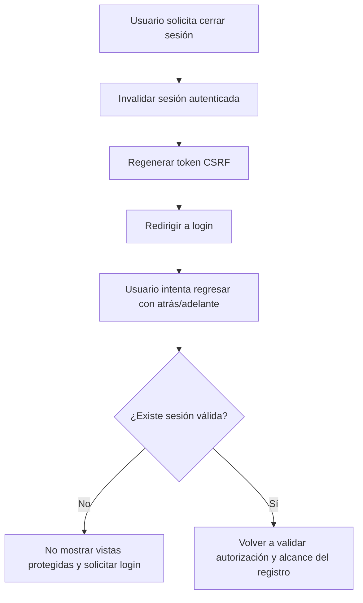

## 12. Controles que atraviesan todos los módulos

1. **Autenticación:** comprobar credenciales y sesión.
2. **Autorización:** aplicar middleware, permisos Spatie, políticas y validaciones de controladores.
3. **Alcance del registro:** validar usuario, consejo, fórmula y propiedad del documento/historial.
4. **Validación de datos:** campos obligatorios, tipos de archivo, estados permitidos, relaciones y duplicidades.
5. **Persistencia:** guardar solo después de superar validaciones.
6. **Interfaz:** mostrar menús, botones, estados y errores coherentes con el permiso real.
7. **Sesión y navegación:** impedir el acceso a vistas privadas después de cerrar sesión.
8. **Notificaciones:** resolver destinatarios desde el backend y validar el destino antes de navegar.

## Pendientes que conviene confirmar antes de declarar el diagrama como “implementación final”

- Si el aviso de privacidad se persiste en base de datos o únicamente se controla mediante sesión/interfaz.
- Si la cuenta y el rol de integrante se crean automáticamente al aprobar una postulación.
- El máximo definitivo de fórmulas por consejo.
- El flujo completo de solicitud, aprobación y notificación del periodo en el cargo.
- Los estados exactos de rechazo/corrección de documentos y justificantes.
- Los permisos efectivos del rol `invitado` en el código actual.

